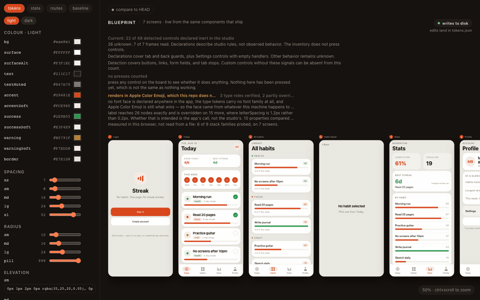
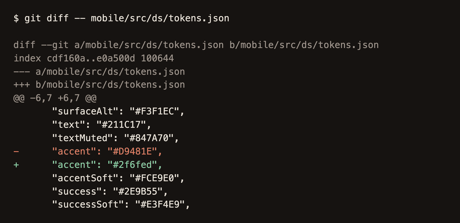

# Streak Studio

A design-token editor that lives **inside** an Expo app and writes its edits back into the codebase as real git diffs.

Drag a colour picker, and every screen repaints at once — in the browser and on a connected simulator — because the token file on disk actually changed. Don't like it? Revert to session start, or `git checkout .`






## Why

Two frictions this removes:

**You can't see the whole app.** A simulator shows one screen at a time. On a real app that hides inconsistency — the button that's 2px off on one screen, the heading that drifted a weight. The studio renders every screen side by side as a blueprint, from the same components that ship, so it can't lie to you.

**Design changes have to be re-typed.** Change a colour in Figma, then change it again in code. The studio removes the second step: the picker writes `tokens.json` and Fast Refresh does the rest. Design work lands as a commit.

The idea comes from Rafael Mendiola's talk *"Build yourself a mobile development environment with Expo web"* (React Native Connection #14). He shipped live colour editing; this goes further — spacing, corner radius, type scale, elevation, and light/dark are all editable, which he named on stage as the obvious next step and left undone.

## Run it

Node 22. A cold clone needs two installs. The app uses npm and the root tools use yarn:

```bash
cd mobile && npm ci && cd ..                 # the Expo app
npx --yes yarn@1.22.22 install --frozen-lockfile   # playwright, for the browser and screenshot checks
npx playwright install chromium              # skip inside the pinned CI image, which ships browsers
```

Then two terminals:

```bash
npm run tokens   # the writer, on :3001
npm run web      # Expo web, on :8081
```

Then open **http://localhost:8081/ide**.

Drag anything in the left panel and watch `git diff mobile/src/ds/tokens.json`.

Drop the `/ide` and you get the plain mobile app at `http://localhost:8081` — same bundle, same components. Run `npm run ios` alongside and token edits land there live too.

Every check a cold clone can run, in one list:

```bash
npm test                 # node:test suite (assertion count is not pinned)
npm run guard            # the app-tree guard, against origin/HEAD
npm run export:web       # the read-only static export into dist/
npm run test:board       # the board: routes, history, movement, camera, persistence
npm run test:present
npm run test:share
npm run test:capture
npm run test:analytics
npm run vr:docker        # the screenshot comparison, in the pinned Linux image
cd mobile && npm run lint && npx tsc --noEmit && cd ..
```

`npm run vr` compares against Linux baselines and fails on a Mac. Run it through `npm run vr:docker`, or in the pinned image. See [the screenshot contract](#the-screenshot-contract).

The native checks need more than a clone. See [the native boundary](#the-native-boundary).

## How it works

The whole thing is six ideas.

**1. The studio is a route, not a project.** `mobile/src/app/ide.tsx` sits next to the app's other routes. It imports the real screens. There is no parallel implementation to keep in sync, and no static analysis — if a screen renders wrong in the blueprint, it renders wrong in the app. A byte-identical guard in CI keeps the app's own screens and shared components untouched while the studio grows around them.

**2. Tokens live in plain JSON.** [`mobile/src/ds/tokens.json`](mobile/src/ds/tokens.json) — colours per scheme, spacing, radius, type scale, elevation. JSON rather than TypeScript is the entire trick: a 90-line server can patch it safely, which is not true of a `.ts` file without a parser.

**3. A tiny server does the writing.** [`token-server/index.mjs`](token-server/index.mjs) exposes `POST /token {path, value}`, sets a dotted path like `color.light.accent`, and writes the file back. Node stdlib only — no dependencies, no build step. Metro sees the file change and Fast Refresh swaps the module into every surface at once. It validates the value against the shape of the leaf before writing, using rules shared with the client so the two cannot disagree.

**4. The studio's own chrome reads no tokens.** Dragging `type.caption.size` used to resize the editor's own labels. The chrome has its own fixed type scale and palette now, so the control for a token cannot distort the studio while you adjust it.

**5. Screens know when they are on the board.** Screens call `useNavigate()` from [`designing.tsx`](mobile/src/ide/designing.tsx). Inside a `DesigningProvider`, navigation stays on the board. The Guide camera centers the destination frame. Board-local history resolves Back. An empty history has no destination. Preview actions use separate history and never count as observed journeys.

Screens are enumerated from the router directory with `require.context`, so adding a route file puts it on the artboard automatically. A hand-written import list goes stale the first time someone forgets — which is exactly the drift the blueprint exists to catch.

## The deployed build

Try it: **https://mrpmohiburrahman.github.io/mobile-development-environment/ide**

The live demo edits tokens **in memory**. Recolouring feels identical, but nothing is written, because a static web build has no filesystem.

To build the same thing locally:

```bash
npm run export:web
npm run preview
```

Then open **http://localhost:8080/ide**.

The normal studio and static export use the Contour board with the Guide camera. No prototype parameter is necessary.
Drag a frame header or footer to move it. Focus a header to use arrow keys, Shift, Home, or Enter.
Frame positions persist in local storage. They never change declared screen order.
**Fit** changes only the camera. **Reset layout** restores frame positions and the camera.
**Reset session** clears board journeys and observations. It preserves layout, token edits, app state, and the state log.

Run the browser checks against this export:

```bash
npm run test:board
```

The check uses one Chromium browser and a temporary static server. It starts no build or token writer.
For a subpath export, use the same `EXPO_BASE_URL` value for this command.

`export:web` writes `dist/`. It bakes the token-server URL `http://127.0.0.1:9`. The client treats that value as read-only and makes no token-server requests. Browsers also block port 9. A local writer cannot receive edits from this build. The export checks every HTML page for incomplete server rendering and verifies its script and stylesheet files.

`preview` serves `dist/` and refuses every method except `GET` and `HEAD`. It binds to `127.0.0.1` and reads `HOST` and `PORT`. The badge says **in-memory only**. The compare toggle says **no committed baseline**, and the baseline tab says there is no token server. Drag a colour. The screens repaint. `git diff` stays empty.

[`.github/workflows/pages.yml`](.github/workflows/pages.yml) runs tests, lint, typechecking, the app-tree guard, and the export before it uploads the Pages artifact. It deploys on every push to `main`.

To check the Pages subpath locally:

```bash
EXPO_BASE_URL=/mobile-development-environment npm run export:web
EXPO_BASE_URL=/mobile-development-environment npm run preview
```

Open **http://localhost:8080/mobile-development-environment/ide**.

That's not a workaround bolted on — it falls out of the design. Edits are an override layer merged over the JSON file, so with a server running the file converges on the override and the override is a no-op; with no server the override is all there is. One code path, both modes.

A badge in the blueprint header says which of the two you're in: **not checked yet** (nothing has been written yet, so nothing has been found out), **writes to disk**, or **in-memory only**. A running server does not earn the badge a claim — it only reports where an edit actually went.

The part a deploy structurally cannot show is the `git diff`, which is the actual point. That's what the GIFs are for.

## Drift

The **baseline** tab compares what you're looking at against what is committed. Turn on *compare to HEAD* and the board draws every screen a second time from `git show HEAD:tokens.json`, beside a list of the tokens that differ.

This is **two renders of the same components against two token sets** — not a pixel diff of two screenshots. Every line it prints names a token in `tokens.json`. A screenshot diff would flag the zoom level, whichever font happened to load, and antialiasing, none of which are drift in the design system.

The baseline column gets *no* override layer. Current tokens are the JSON file plus your unsaved edits; the baseline is `HEAD`. Applying your edits to both sides would make the two columns agree on exactly the tokens you are editing, and the tool would report no drift for the edits most worth seeing.

Where a difference cannot be traced to a single token — two tokens holding the same value, say — it shows the family (`color, unattributed`) rather than guessing.

## The screenshot contract

The **baseline** tab is not a screenshot check, and the screenshot suite is not a baseline check. They answer different questions and neither replaces the other.

| | **baseline** tab | screenshot suite |
|---|---|---|
| Compares | two renders of the same components, against two token sets | two PNG files, pixel by pixel |
| Reports | a named token in `tokens.json` | a pass, or a diff image |
| Runs | in the studio, in your browser, live | in CI, in a pinned Linux container |
| Catches | a token you edited that moved a screen you did not look at | any pixel change at all, including one no token explains |

The suite captures each registered screen in both schemes at 390 by 820 CSS pixels and DPR 2, through Capture mode (`?capture=1&screen=<key>&scheme=<light|dark>&state=<populated|empty>`). Capture mode renders one app surface at scale 1 with committed tokens and no studio chrome. The fixture applies before the surface paints. The page sets `data-screenshot-ready` only after the fonts load, the images decode, and the browser honours reduced motion. An invalid request shows `#capture-error` and never sets that marker.

Baselines are **Linux-only** ([ADR 0002](docs/adr/0002-linux-only-screenshot-baselines.md)). Mac and Linux rasterise different pixels even with a bundled font, so a Mac baseline would make CI fail on every pull request. The pinned image is `mcr.microsoft.com/playwright:v1.58.0-noble` on `linux/arm64`, matching the `devDependencies.playwright` version. The threshold is 0.

```bash
npm run vr:docker     # compare inside the pinned image; this is what CI runs
npm run vr:update     # rewrite the baselines, only inside that same image
```

`vr:update` writes the PNGs and `mobile/src/ide/screenshot-record.json`, and you commit both for review. CI never writes or commits a baseline. A screen registered without baselines fails the suite rather than passing silently, and a missing record case fails too.

The **regression** tab in the studio shows that record: `Approved at <commit>`, the image, the capture size, and each case with its scheme, state, and baseline path. It renders no images, follows no links, and fetches nothing. A `null` record reads `No screenshot run on record` in amber, which looks different from an approved record with zero diffs. The tab does not claim this build passed — HEAD can be newer than the recorded commit, and only the CI comparison checks a build.

## What the app does

Three panels answer three questions about the running app, and none of them needs a second tool to answer.

**state** is a change log, not a snapshot. Toggle a habit's check on the board and a row appears naming the store it landed in, the path that moved, and its old and new value. Sign in while you are already signed in and no row appears, because the log records what changed rather than what was called. The log watches both stores, so switching the colour scheme in the Settings frame — which repaints every frame on the board — is a row rather than a silence. The live state tree stays below the log, because the log cannot answer "what is it right now".

**routes** lists navigation evidence and highlights the selected frame. The board shows declared routes before interaction. Dashed connections are declared. Solid connections are observed. The active connection stays accented until the next navigation action. Direct connections use side midpoints. Detours use separate lanes above the row. **Include tabs** displays the declared tab connections. App controls record observed routes without leaving the studio.

**Studio evidence** contains the control inventory, press counts, and render fidelity measurements. A press that changes nothing is **inert in the studio**. Tab controls and Back now use board navigation in current frames. Comparison frames retain their navigation guards. Settings controls with empty handlers remain declared inert.

A press is never reported as the cause of a change. The log shows what changed and where the press landed as two facts side by side, with no arrow between them, because the change usually repaints a different frame than the one pressed.

## What the browser actually rendered

The studio assumes the render on screen is the render that was designed. The header checks, and prints the answer next to the board it applies to.

It probes which family actually won the display font stack by rendering a test string in each candidate and in two known-different references, and comparing widths. Every candidate is named with its fate — present, fell through, or unmeasured — and an unanswerable one is never reported as fine. It then checks the `type.*` tokens against the computed styles of the text on the real screens, and reports how many screens and how many properties it compared.

The app includes Spline Sans weights 400, 600, and 700 from `@expo-google-fonts/spline-sans` version 0.4.2. The original font files and SIL OFL license are in `mobile/public/fonts/spline-sans/`.

Web uses weighted `@font-face` declarations. The export converts public font URLs to relative paths for root and subpath deployments. The `type.family` token selects Spline Sans through shared Text, tabs, Back, buttons, and chips. The client and server reject font families outside the bundled allow-list. The display weight is 700. Existing smoothing settings remain unchanged.

The `expo-font` plugin includes the same files in native builds. Android defines the family with explicit weights. iOS reads the family from the font files. Run `npx expo run:ios` from `mobile/` to rebuild the native app after font changes. A Metro restart or Expo Go session does not apply the plugin. Check the rebuilt app before reporting native font verification.

The header waits for the web fonts before it measures the browser render. This check does not prove native font loading or identical native rasterization. The older GIFs and still record their capture sessions, not a font baseline for the current build.

## The native boundary

Only the native app sends Mixpanel events ([ADR 0003](docs/adr/0003-native-app-only-mixpanel-events.md)). The studio on web renders the same screens and sends nothing, in dev and on the GitHub Pages build alike.

The rule lives in one module, `mobile/src/analytics/mixpanel.ts`, which every call site goes through. It refuses before it reads a token, before it reads storage, and before it opens a socket. A screen added later cannot bypass it by accident. The refusal reasons are `web`, `not-configured`, `unknown-region`, and `studio-route`.

There is no SDK. The sender POSTs a form-encoded `data=` payload to the regional ingestion host with plain `fetch`. An unknown region is refused by name rather than falling back to the US host, because the US host answers `status: 1` for another region's token and the events vanish.

Four events, and only these properties:

| Event | Properties | Leaves when |
|---|---|---|
| `App Opened` | `platform` | once per JS runtime, not once per root-layout mount |
| `Screen Viewed` | `screen` | the normalized pathname differs from the last one sent |
| `Habit Toggled` | `habit_id`, `done` | a habit's check changes |
| `Signed Out` | — | the session ends |

No habit text, no state, no tokens. Identity is one UUIDv4 per install, kept in AsyncStorage under `mixpanel.install_id` and sent as `$device_id` and `distinct_id: $device:<uuid>`. Each event carries its own `$insert_id` so Mixpanel deduplicates a retry.

Configure it in `mobile/.env.local`, which git ignores:

```
EXPO_PUBLIC_MIXPANEL_TOKEN=<project token>
EXPO_PUBLIC_MIXPANEL_REGION=us   # or eu / in
```

Expo inlines only literal `process.env.EXPO_PUBLIC_*` member expressions, so the sender reads both that way. With no token the app still works and the sender reports `not-configured`. The clone stays credential-free, and the public Pages build needs no Mixpanel secret.

`accepted` means the ingestion host answered `status: 1`. That is an HTTP acceptance, **not** proof an event reached a report. Mixpanel drops some accepted events silently. Only the project's Events page proves arrival. This environment has not verified Events-page arrival. A request from a browser, from Node, or from the token server is not a substitute. It exercises no platform guard, no install identity, and no native UUID generator.

The studio's **analytics** tab is a note, not a send log. It states the boundary, links to [the project](https://mixpanel.com/project/4074212), and reads `Mixpanel: not configured` when the web build has no token. It never prints the token, a log, or a dashboard. A configured web build still shows the caveat that a token there proves nothing about the native app.

`npm run test:analytics` proves the silence. It exports the studio twice, once with no token and once with a test token. It performs native-equivalent habit, sign-out, and navigation actions in both, intercepts every regional ingestion host, and asserts zero outgoing analytics requests.

## The five ideas from the talk

Rafael Mendiola left five bullets on a slide at RNCK #14. Here is where each one landed, and why.

| Idea | Where it landed |
|---|---|
| Watch state change | **Built.** It is the `state` tab, as a change log rather than a tree. |
| Visualize navigation routes | **Built.** It is the `routes` tab, plus edges drawn on the board between the frames. |
| Plug in MixPanel | **Built, native-only.** Four events reach a real project from the app. The SDK is still declined. |
| Visual regression on web | **Built.** A real screenshot suite with committed Linux baselines, and the measured verdict beside it. |
| Blueprint for stakeholders | **Built.** Present mode, and a shareable URL that reproduces an exact view. |

**The analytics SDK is declined, for three stated reasons, and the events are not.** An SDK is a runtime dependency in a repo whose server is Node-stdlib-only and whose test command is `node --test`. A committed project token would break the deliberate credential-free clone. A vendor SDK is orthogonal to a tool whose whole claim is that design changes land as git diffs. All three still hold, so the sender is a small `fetch` module behind adapters and the token stays in a gitignored file. The studio on web sends nothing at all. Events leaving the running app are real on a device and a simulator, which is what the talk asked for. The `state` tab still shows the studio's own spine, not a send log.

**Visual regression on web needed a bundled font, and now it has one.** The app ships Spline Sans 400, 600, and 700. A captured pixel no longer depends on the face the host happens to hold. Two checks sit side by side and neither subsumes the other. The **baseline** tab attributes a change to a named token. The screenshot suite catches any pixel that moved, including one no token explains. See [the screenshot contract](#the-screenshot-contract).

**The blueprint is not a design tool, and not a record of what was agreed.** It is a development tool for editing tokens. It has no memory beyond your session. On the deployed build your edits are yours alone and are written nowhere. Present mode and the shareable URL make one view reproducible for a conversation. They do not make the board a record of a decision.

## Share it

The deployed build and the GIFs above are enough to hold a conversation about the app's shape. What the blueprint is good for is the question such a conversation actually starts with — *which screens exist, and how do they connect* — which is what the **routes** tab answers and what a single screenshot never will.

For the conversation itself, **Present mode** hides the studio. Press the Present button or `P`. In overview the nearest screen frame opens. After a camera flight the target screen opens. The app surface centers at viewport height over 820, clamped between 0.5 and 1.5. The side panel hides and token editing turns off, so nothing in the room can be dragged by accident. A bar holds the screen label, `N / 7`, the Light/Dark toggle, and Exit. Left and Right step through screens, `L` flips the scheme, and `P` or Escape leaves.

The app stays live throughout. The spine keeps recording, so a habit toggled during a presentation is still a row in the state log afterwards.

**A link reproduces the view.** The whole shared state lives in the hash fragment as `#s=<payload>`. It holds a version tag, the present flag, the screen key, the scheme, and your token overrides as a diff against the committed `tokens.json`. Deflate compresses it and base64url encodes it. The URL updates through `replaceState` 400 ms after a shared field stops changing. **Copy link** encodes the view at the moment you click.

Each part of a link validates separately. An unknown token, an out-of-range value, a missing screen, malformed compression, or a payload from a newer version shows a dismissible banner. The banner names what it could not apply, and the valid parts still apply. An unknown screen key opens the first screen. A link never crashes the studio, and a link that carries nothing opens the plain board.

The limit is the one the deployed build cannot escape: a link carries your *token overrides*, not the app's state or your board history. Opening it on Pages reproduces the view you shared. It does not restore a session, and it cannot write to disk.

## The guard

`scripts/guard.sh` is the reason the blueprint is worth trusting. It fails any change to `mobile/src/app` or `mobile/src/ui`. The studio renders the real screens to make its claims demonstrable. If it can quietly edit those screens, the rendering proves nothing.

Two paths are permanent exceptions. `mobile/src/app/ide.tsx` is the studio's own route. `mobile/src/ui/index.tsx` holds the shared TabBar and BackBar controls, which report suppressed designing presses to the studio's navigation seam, and the shared font family.

Everything else in the app tree needs permission, granted per commit ([ADR 0004](docs/adr/0004-guard-permission-per-commit.md)):

```
Guard-Allow: mobile/src/app/habit.tsx -- fix the weekday label
```

The path must be exact and the reason must be non-empty. The permission holds only inside the head-side commit range you pass to the guard. Merged history does not grant it. A base-only commit does not grant it. The next branch needs its own trailer. A reasonless trailer, an unpermitted change, or a range that will not resolve exits 1. That last case matters, because a shallow clone would otherwise make the guard pass by failing to diff. On success the guard prints every permitted path with its reason.

`test/guard.test.ts` builds throwaway repositories to prove that. It covers the rename, deletion, nested-route, default-base, and broken-range cases, and it runs both CI workflows against the ranges they actually pass.

## Undo

Two different intentions, so two different actions:

- **Revert to session start** — back to the file as it was when this session's first edit landed. Half-finished work from *before* you opened the studio survives.
- **Discard everything → last commit** — `git checkout`. Destroys uncommitted work the studio never saw, so it is a separate button with its own wording.

Each edited row also has its own `undo`. Both run on the same snapshot; there is one mechanism, not two.

## Layout

```
mobile/
  src/app/          routes — 7 app screens + ide.tsx        (guarded)
  src/ui/           token-driven components                 (guarded, one exception)
  src/ds/           tokens.json, the store, the server client, validation
  src/ide/          blueprint, board, token / baseline / state / route /
                    analytics / regression panels, capture mode, present mode,
                    URL state and the spine
  src/analytics/    the sender, the route observer, the hook, the adapters
  public/fonts/     Spline Sans 400 / 600 / 700 and the OFL license
token-server/       the writer, Node stdlib only
test/               node:test, no framework, no build step, no runtime dependency
browser/            the five Playwright checks against the static export
vr/                 the screenshot suite: capture, compare, record, summary
e2e/__screenshots__/  the 16 committed Linux baselines
scripts/
  guard.sh          the byte-identical guard
  export-web.sh     the read-only web export, into dist/
  serve-static.mjs  the local preview of dist/, read-only
  vr-docker.sh      the suite inside the pinned Playwright image
docs/adr/           the five decisions these boundaries come from
```

## Known limits

- The studio is web-only by design; opening `/ide` on a device shows a note saying so.
- The session baseline lives in the token server's memory. Restart it mid-session and undo has nothing to go back to — the panel says so rather than restoring something arbitrary.
- Token values are validated by the shape of the leaf they go into — hex colour, number in range, a real `box-shadow` — on both sides, so a bad value is refused rather than written. `rgb()` is refused: nothing in the app parses it, so accepting it would write a value that renders as garbage.
- Elevation is edited as text, not a slider, because it is a whole CSS value rather than a number.
- Drift detection reports store state as it is. A screen showing an empty state reports nothing even if its populated state would drift.
- The compare view draws 14 screens at once. It is opt-in, and it runs fine at `reactCompiler: true` — but it is a deliberate toggle, not the default.
- The change log keeps its last 200 rows and says so when it drops any. It is not persisted: reloading the page clears it, because the deployed build is per-visitor and its state is too.
- Board-local history resets on reload. Preview history stays separate from observed journeys. Reset session clears board history and evidence, not app state or the state log.
- The render verdict describes this browser. Bundled fonts remove reliance on an installed face, but web and native rasterization can differ.
- Spline Sans has no 800 weight, so the `display` token renders at 700. The family allow-list rejects anything not bundled.
- Analytics has no retry and no offline queue. An `unsent` event is gone, and the spec rules a durable queue out of scope. `accepted` is an HTTP answer, not a delivery.
- Analytics has no native end-to-end proof in this clone. The Mixpanel token file is gitignored and absent. Events-page arrival, the per-launch App Opened count, and toggle payload contents stay unverified, and outbound requests do not prove arrival. The web suite verifies the sender against a local stand-in. No Android runtime verification has run, and nothing here claims real users before an App Store release.
- A habit toggled or a sign-out performed while the device shows `/ide` is suppressed. Those are the developer's presses, not a user's.
- Screenshot baselines are Linux-only and the threshold is 0. `npm run vr` on a Mac fails on rasterization differences that are not drift. Use `npm run vr:docker`.
- The suite covers 16 cases: seven registered screens in both schemes, plus Habit detail empty in both. It does not cover every empty state, extra widths, DPR variants, board PNGs, or native screenshots.
- The **regression** tab reports a bundled record. It does not fetch, does not read CI artifacts, and does not prove the build you are looking at passed.
- A shared link carries the present flag, screen key, scheme, and token overrides. It does not carry app state, board history, or the state log, and it cannot write to disk.
- The tracked `expo-build-properties` plugin sets `ios.enableSceneSupport`, and iOS 27 launches the generated project unmodified. Headless verification cannot approve the SpringBoard confirmation for `mobile://` links. Native checks cover launch, the Today screen, and bundled fonts.
