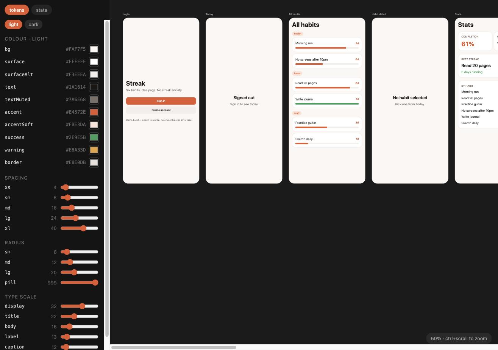

# Streak Studio

A design-token editor that lives **inside** an Expo app and writes its edits back into the codebase as real git diffs.

Drag a colour picker, and every screen repaints at once — in the browser and on a connected simulator — because the token file on disk actually changed. Don't like it? Revert to session start, or `git checkout .`



## Why

Two frictions this removes:

**You can't see the whole app.** A simulator shows one screen at a time. On a real app that hides inconsistency — the button that's 2px off on one screen, the heading that drifted a weight. The studio renders every screen side by side as a blueprint, from the same components that ship, so it can't lie to you.

**Design changes have to be re-typed.** Change a colour in Figma, then change it again in code. The studio removes the second step: the picker writes `tokens.json` and Fast Refresh does the rest. Design work lands as a commit.

The idea comes from Rafael Mendiola's talk *"Build yourself a mobile development environment with Expo web"* (React Native Connection #14). He shipped live colour editing; this goes further — spacing, corner radius, type scale, elevation, and light/dark are all editable, which he named on stage as the obvious next step and left undone.

## Run it

Two terminals. Node 22.

```bash
npm run tokens   # the writer, on :3001
npm run web      # Expo web, on :8081
```

Then open **http://localhost:8081/ide**.

Drag anything in the left panel and watch `git diff mobile/src/ds/tokens.json`.

Drop the `/ide` and you get the plain mobile app at `http://localhost:8081` — same bundle, same components. Run `npm run ios` alongside and token edits land there live too.

## How it works

The whole thing is six ideas.

**1. The studio is a route, not a project.** `mobile/src/app/ide.tsx` sits next to the app's other routes. It imports the real screens. There is no parallel implementation to keep in sync, and no static analysis — if a screen renders wrong in the blueprint, it renders wrong in the app. A byte-identical guard in CI keeps the app's own screens and shared components untouched while the studio grows around them.

**2. Tokens live in plain JSON.** [`mobile/src/ds/tokens.json`](mobile/src/ds/tokens.json) — colours per scheme, spacing, radius, type scale, elevation. JSON rather than TypeScript is the entire trick: a 90-line server can patch it safely, which is not true of a `.ts` file without a parser.

**3. A tiny server does the writing.** [`token-server/index.mjs`](token-server/index.mjs) exposes `POST /token {path, value}`, sets a dotted path like `color.light.accent`, and writes the file back. Node stdlib only — no dependencies, no build step. Metro sees the file change and Fast Refresh swaps the module into every surface at once. It validates the value against the shape of the leaf before writing, using rules shared with the client so the two cannot disagree.

**4. The studio's own chrome reads no tokens.** Dragging `type.caption.size` used to resize the editor's own labels. The chrome has its own fixed type scale and palette now, so the control for a token cannot distort the studio while you adjust it.

**5. Screens know when they're being designed.** Inside the blueprint a tap must not navigate, or the whole artboard would sail off to one route. Screens call `useNavigate()` from [`designing.tsx`](mobile/src/ide/designing.tsx), which no-ops under a `DesigningProvider`. Context rather than a `designing` prop, because Expo Router owns screen mounting — there's no single call site to thread a prop from.

Screens are enumerated from the router directory with `require.context`, so adding a route file puts it on the artboard automatically. A hand-written import list goes stale the first time someone forgets — which is exactly the drift the blueprint exists to catch.

## The deployed build

The live demo edits tokens **in memory**. Recolouring feels identical, but nothing is written, because a static web build has no filesystem.

That's not a workaround bolted on — it falls out of the design. Edits are an override layer merged over the JSON file, so with a server running the file converges on the override and the override is a no-op; with no server the override is all there is. One code path, both modes.

A badge in the blueprint header says which of the two you're in: **not checked yet** (nothing has been written yet, so nothing has been found out), **writes to disk**, or **in-memory only**. A running server does not earn the badge a claim — it only reports where an edit actually went.

The part a deploy structurally cannot show is the `git diff`, which is the actual point. That's what the GIFs are for.

## Drift

The **baseline** tab compares what you're looking at against what is committed. Turn on *compare to HEAD* and the board draws every screen a second time from `git show HEAD:tokens.json`, beside a list of the tokens that differ.

This is **two renders of the same components against two token sets** — not a pixel diff of two screenshots. Every line it prints names a token in `tokens.json`. A screenshot diff would flag the zoom level, whichever font happened to load, and antialiasing, none of which are drift in the design system.

The baseline column gets *no* override layer. Current tokens are the JSON file plus your unsaved edits; the baseline is `HEAD`. Applying your edits to both sides would make the two columns agree on exactly the tokens you are editing, and the tool would report no drift for the edits most worth seeing.

Where a difference cannot be traced to a single token — two tokens holding the same value, say — it shows the family (`color, unattributed`) rather than guessing.

## What the app does

Three panels answer three questions about the running app, and none of them needs a second tool to answer.

**state** is a change log, not a snapshot. Toggle a habit's check on the board and a row appears naming the store it landed in, the path that moved, and its old and new value. Sign in while you are already signed in and no row appears, because the log records what changed rather than what was called. The log watches both stores, so switching the colour scheme in the Settings frame — which repaints every frame on the board — is a row rather than a silence. The live state tree stays below the log, because the log cannot answer "what is it right now".

**routes** lists how the screens connect. Each row says how it was learned: **observed** at the studio's navigation seam, **declared** from the router's directory, or **unresolved**. The four tab destinations are real routes the studio cannot watch, because the tab bar reaches the router directly and the studio does not edit that file. The back control resolves against history at press time, so it is reported as a gap with a count rather than drawn as an edge. The counts come before the list, so a reader who sees a headline number is told how it was arrived at.

**the board header** counts every press. Roughly half the controls on the board dim under your finger and then do nothing — the avatar, the stats card, all sixteen tab taps, the back bars. A press that changed nothing is reported as **inert in the studio**, which names the studio's limitation rather than calling the control broken. The studio cannot tell a control that is inert here from one that is unimplemented everywhere, so it does not claim to.

A press is never reported as the cause of a change. The log shows what changed and where the press landed as two facts side by side, with no arrow between them, because the change usually repaints a different frame than the one pressed.

## What the browser actually rendered

The studio assumes the render on screen is the render that was designed. The header checks, and prints the answer next to the board it applies to.

It probes which family actually won the display font stack by rendering a test string in each candidate and in two known-different references, and comparing widths. Every candidate is named with its fate — present, fell through, or unmeasured — and an unanswerable one is never reported as fine. It then checks the `type.*` tokens against the computed styles of the text on the real screens, and reports how many screens and how many properties it compared.

**Measured answer: no, not today.** The display stack names two families ahead of the system fallbacks. Neither is installed on the machine this was written on, no font face is declared anywhere in the app, and the type tokens carry no font family at all — so the stack resolves to the system face here, to a different face on a machine that has the named family, and to a third on Linux. Three machines, three rasters, one committed tree.

That is the claim the board's header is making when it prints this line.

## The five ideas from the talk

Rafael Mendiola left five bullets on a slide at RNCK #14. Here is where each one landed, and why.

| Idea | Where it landed |
|---|---|
| Watch state change | **Built.** It is the `state` tab, as a change log rather than a tree. |
| Visualize navigation routes | **Built.** It is the `routes` tab, with every row labelled by how it was learned. |
| Plug in MixPanel | **Declined.** The event stream is built; the SDK is not. |
| Visual regression on web | **Reshaped.** The condition it was hedged behind is now measured, and the verdict is above. |
| Blueprint for stakeholders | **No code.** The blueprint is already shareable; the gap was this paragraph. |

**The analytics SDK is declined, for three stated reasons.** It is a runtime dependency in a repo whose server is Node-stdlib-only and whose test command is `node --test`. A project token would be committed, which breaks the deliberate credential-free clone. And it is orthogonal to a tool whose whole claim is that design changes land in the codebase as git diffs. What is kept is its *shape* — a chronological stream of events from the running app — and that is what the `state` tab already is.

**Visual regression on web is declined on a precondition, not on principle.** The talk's author attached the idea to a confidence condition: *if I have a reasonable confidence that what is displayed here will be what's displayed on mobile*. The condition is checkable, and the header checks it. The answer is no, and the reason is fonts. Any visual regression that is font-independent must exclude geometry, because geometry is font-dependent through text wrapping; exclude geometry and it is not a visual regression at all. It is the style comparison the **baseline** tab already does, plus a node count. When a web font ships, the verdict line changes and the question becomes answerable again.

**The blueprint is not a design tool, and not a record of what was agreed.** It is a development tool for editing tokens, and it has no memory beyond your session. On the deployed build your edits are yours alone and are written nowhere.

## Share it

The deployed build and the GIFs above are enough to hold a conversation about the app's shape. What the blueprint is good for is the question such a conversation actually starts with — *which screens exist, and how do they connect* — which is what the **routes** tab answers and what a single screenshot never will.

## Undo

Two different intentions, so two different actions:

- **Revert to session start** — back to the file as it was when this session's first edit landed. Half-finished work from *before* you opened the studio survives.
- **Discard everything → last commit** — `git checkout`. Destroys uncommitted work the studio never saw, so it is a separate button with its own wording.

Each edited row also has its own `undo`. Both run on the same snapshot; there is one mechanism, not two.

## Layout

```
mobile/
  src/app/          routes — 7 app screens + ide.tsx
  src/ds/           tokens.json, the store, the server client, validation
  src/ide/          blueprint, token panel, baseline panel, designing context
                    plus the spine, the route list and the render verdict
  src/ui/           token-driven components
token-server/       the writer
test/               node:test, no framework, no build step, no dependency
scripts/guard.sh    the byte-identical guard
```

## Known limits

- The studio is web-only by design; opening `/ide` on a device shows a note saying so.
- The session baseline lives in the token server's memory. Restart it mid-session and undo has nothing to go back to — the panel says so rather than restoring something arbitrary.
- Token values are validated by the shape of the leaf they go into — hex colour, number in range, a real `box-shadow` — on both sides, so a bad value is refused rather than written. `rgb()` is refused: nothing in the app parses it, so accepting it would write a value that renders as garbage.
- Elevation is edited as text, not a slider, because it is a whole CSS value rather than a number.
- Drift detection reports store state as it is. A screen showing an empty state reports nothing even if its populated state would drift.
- The compare view draws 14 screens at once. It is opt-in, and it runs fine at `reactCompiler: true` — but it is a deliberate toggle, not the default.
- The change log keeps its last 200 rows and says so when it drops any. It is not persisted: reloading the page clears it, because the deployed build is per-visitor and its state is too.
- The four tab routes are declared from the router directory rather than watched, and the back control is counted from the board rather than resolved. Neither can be more than that without editing the app's own files, which the guard forbids.
- The render verdict describes this browser, on this machine. A machine with the named display font installed will print a different answer, which is the point.
